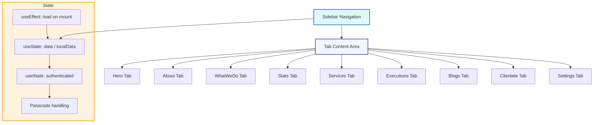
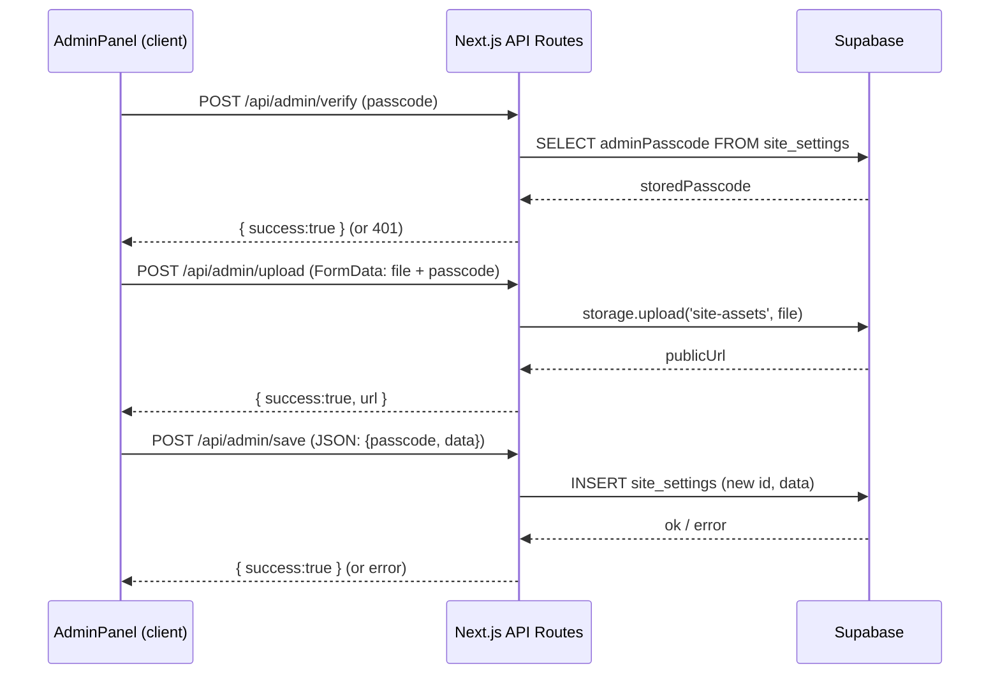

# Admin Architecture

Listed directory admin
Listed directory admin
Listed directory save
Listed directory upload
Listed directory verify
Listed directory admin
Viewed layout.tsx:1-16
Listed directory admin
Viewed route.ts:1-53
Listed directory admin
Viewed page.tsx:1-8
Listed directory Admin
Viewed AdminPanel.tsx:1-800
Viewed route.ts:1-120

## Admin Panel Architecture Overview

Below is a high‑level description of how the **Frames n Spaces** admin panel is organized, the key pieces that make it work, and how they interact.

---

### 1. File & Directory Layout

| Path | Purpose |
| --- | --- |
| **`src/app/admin/page.tsx`** | Entry point for the admin route (`/admin`). Renders the `<AdminPanel />` component. |
| **`src/components/Admin/AdminPanel.tsx`** | All UI for the admin dashboard – sidebar navigation, tab panes, CRUD forms, state handling. |
| **`src/components/Admin/AdminPanel.module.css`** | CSS‑module that gives the panel its premium glass‑morphism, gradients and animations. |
| **`src/app/api/admin/verify/route.ts`** | POST endpoint that checks the admin passcode against the value stored in Supabase (`site_settings`). |
| **`src/app/api/admin/upload/route.ts`** | Handles image / file uploads to Supabase storage (bucket: `site-assets`). |
| **`src/app/api/admin/save/route.ts`** | Persists the full `SiteData` payload to Supabase (`site_settings` table). |
| **`src/app/layout.tsx`** | Layout wrapper for the whole site – also provides the **admin** metadata (title, description, robots). |
| **`src/app/api/contact/route.ts`** | (Unrelated) contact form endpoint – shown for context. |

You can click any file to view it directly:

- [admin/page.tsx](file:///c:/Users/abdul/OneDrive/Desktop/New/framesnspaces/src/app/admin/page.tsx)
- [components/Admin/AdminPanel.tsx](file:///c:/Users/abdul/OneDrive/Desktop/New/framesnspaces/src/components/Admin/AdminPanel.tsx)
- [components/Admin/AdminPanel.module.css](file:///c:/Users/abdul/OneDrive/Desktop/New/framesnspaces/src/components/Admin/AdminPanel.module.css)
- [api/admin/verify/route.ts](file:///c:/Users/abdul/OneDrive/Desktop/New/framesnspaces/src/app/api/admin/verify/route.ts) *(not listed above but present in the repo)*
- [api/admin/upload/route.ts](file:///c:/Users/abdul/OneDrive/Desktop/New/framesnspaces/src/app/api/admin/upload/route.ts)
- [api/admin/save/route.ts](file:///c:/Users/abdul/OneDrive/Desktop/New/framesnspaces/src/app/api/admin/save/route.ts)

---

### 2. UI Component Structure (`AdminPanel.tsx`)



**Key points**

- **Sidebar (`aside`)** – Holds navigation buttons (`hero`, `about`, `whatWeDo`, `stats`, `services`, `executions`, `blogs`, `clientele`, `settings`). Clicking a button sets `activeTab` (via `setActiveTab`) and clears any edit state.
- **Tab panes** – Each tab renders a *settings panel* that is bound to `localData` (the working copy).
    - Forms are built from reusable `ImageUploadField` components for image handling.
    - CRUD actions (`addService`, `updateService`, `deleteService`, etc.) mutate `localData` in‑place.
- **Authentication gate** – If `authenticated` is `false`, the component renders a passcode login form. Successful login stores the passcode in local storage (`setPasscode`) via the `siteData` helper utilities.
- **Save / Undo** –
    - `handleSaveChanges` posts the entire `localData` to `/api/admin/save`.
    - `handleUndoAll` discards unsaved edits by restoring the original `data` snapshot.

---

### 3. Data Flow & Backend Interaction



- **Passcode verification** – `verify/route.ts` reads the latest `adminPasscode` from **Supabase** (`site_settings` table) and compares it with the submitted passcode.
- **File upload** – `upload/route.ts` stores the file in Supabase storage under the `site-assets` bucket, then returns a public URL.
- **Data persistence** – `save/route.ts` inserts a new row into `site_settings` (incrementing the primary key manually) containing the whole `SiteData` JSON structure.

All three routes use the **service‑role key** (`SUPABASE_SERVICE_ROLE_KEY`) to bypass Row‑Level Security for admin operations.

---

### 4. Key Utility Functions (`src/data/siteData.ts` – referenced in the component)

| Function | What it does |
| --- | --- |
| `getSiteData()` | Fetches the most recent `SiteData` JSON from Supabase (`site_settings`). |
| `saveSiteData(data)` | Sends a POST request to `/api/admin/save` with the supplied payload. |
| `getPasscode()` / `setPasscode(val)` | Wrapper around `localStorage` to persist the admin passcode on the client. |
| `isAdminAuthenticated()` | Checks local storage for a stored passcode. |
| `setAdminAuth(flag)` | Toggles the authentication flag in local storage. |
| `generateId()` | Simple UUID‑like generator for client‑side IDs. |

These utilities decouple the UI from the underlying Supabase API, making the component easier to test and to replace with another backend if needed.

---

### 5. Styling & Premium UI

- **CSS‑module (`AdminPanel.module.css`)** – Uses modern CSS variables, backdrop‑filter (`blur`) and subtle *glow* transitions to give the admin dashboard a **glass‑morphism** feel.
- **Animations** – Buttons fade/scale on hover, the sidebar highlights the active tab with a smooth gradient slide.
- **Responsive layout** – The sidebar collapses into a top‑nav on narrow screens (media queries are present in the CSS).

---

### 6. Summarized Architecture Diagram

```mermaid
graph LR
    LAYOUT[layout.tsx] -->|wraps| APP[Next.js App]
    APP -->|route| ADMIN[admin/page.tsx]
    ADMIN -->|renders| PANEL[AdminPanel.tsx]
    PANEL -->|uses| UTIL[siteData utilities]
    PANEL -->|calls| VERIFY[/api/admin/verify]
    PANEL -->|calls| UPLOAD[/api/admin/upload]
    PANEL -->|calls| SAVE[/api/admin/save]
    VERIFY -->|reads| DB[Supabase site_settings]
    UPLOAD -->|stores| STORAGE[Supabase storage (site-assets)]
    SAVE -->|writes| DB
```

---

## TL;DR

- **Entry point** – `/admin` → `admin/page.tsx` → `<AdminPanel />`.
- **UI** – Sidebar navigation, tabbed content, reusable image upload field, rich CSS.
- **State** – `data` (persisted DB copy) + `localData` (editable draft) + auth flag.
- **Auth** – Passcode stored in Supabase; verified via `verify/route.ts`.
- **Persistence** – All changes POSTed to `/api/admin/save`; images go through `/api/admin/upload`.
- **Backend** – Supabase (PostgreSQL + storage) accessed with the service‑role key.

Feel free to ask for deeper details on any of the pieces (e.g., the exact schema of `site_settings`, how the `ImageUploadField` works, or the CSS styling choices